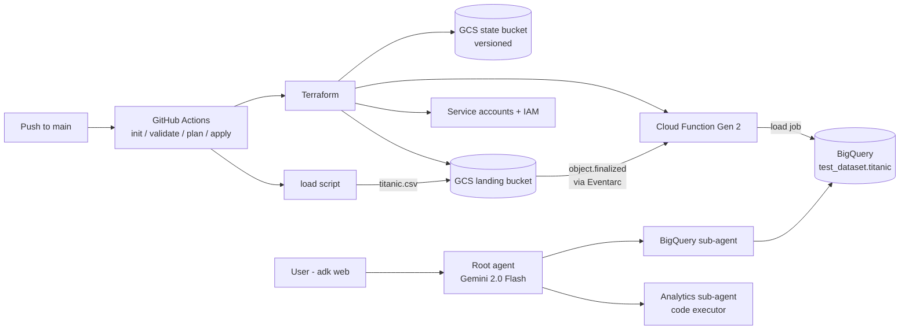

**Repo:** [JeanFraga/Agentic-Data-Science](https://github.com/JeanFraga/Agentic-Data-Science)

## Goal

Two things in one project:

1. An **event-driven ingestion platform** on GCP. Dropping a CSV into a bucket loads it into BigQuery automatically, and every API, bucket, dataset, service account and function is defined in **Terraform** and deployed by **GitHub Actions**.
2. A **conversational analyst** built with Google's Agent Development Kit (ADK) that answers questions about the loaded data.

The Titanic dataset is the worked example.

## Architecture

### Ingestion

- A script creates the dataset if it's missing and uploads the CSV to the landing bucket.
- The `object.finalized` event reaches a **Cloud Functions Gen 2** function through **Eventarc**. The function runs Python 3.11 with retries on and its own service account.
- The function ignores unexpected files and decodes defensively: UTF-8, then latin-1, then cp1252.
- It normalizes column names and loads the table with `WRITE_TRUNCATE`, typing every column as STRING. Raw-first: typing happens downstream.

### The agent

- A root agent on **Gemini 2.0 Flash** routes to two sub-agents, each wrapped as an `AgentTool`:
  - a **BigQuery agent** with query, schema-lookup and count tools
  - an **analytics agent** that uses ADK's built-in code executor for pandas-style analysis
- A `before_agent_callback` injects the table schema into the root agent's instructions, so the model writes SQL against real column names.
- The agent runs locally through `adk web`.

### Terraform and CI

- Terraform state lives in a versioned, public-access-blocked GCS bucket.
- Five service accounts are defined in code, each with its own role set (`for_each`) and dataset-level grants. GitHub Actions, the function and three agent identities each get their own account, and the agent account can impersonate the others.
- On pull requests, CI runs `init`, `validate` and `plan`. On `main` it applies, then runs the load script as an end-to-end smoke test.

## Problems I hit (and fixed)

- **Duplicate IAM definitions.** A second permissions file granted the function `bigquery.admin` and conflicted with my cleanup. I consolidated to one file and cut the function down to `dataEditor`, `user` and `objectViewer`. Gen 2 then needed `run.invoker` and `eventarc.eventReceiver`, and the GCS service agent needed `pubsub.publisher`.
- **Moving from Gen 1 to Gen 2.** I moved from `google_cloudfunctions_function` to `google_cloudfunctions2_function`, rewrote the handler for CloudEvents, and added Cloud Run, Eventarc and Artifact Registry permissions.
- **IAM as code.** Service accounts I had created by hand in the console moved into Terraform, so the whole project is reproducible.
- **ADK 1.0 API changes.** After upgrading, Pydantic errors appeared. The fix was renaming `system_instruction` to `instruction` and giving every agent a `name`.
- **Templating for publishing.** Before making the repo public I replaced the hard-coded project ID with a placeholder throughout the docs.

## What I'd do next

- Switch CI from a service-account key to **Workload Identity Federation**. I did this in my [next project]().
- Add a typed Silver table so the agent doesn't have to cast STRING columns.
- Make the agent's SQL tool read-only.
- Have the agent actually use the dedicated BigQuery ML and Vertex AI identities I provisioned, then deploy it instead of running it locally.

## What I learned

Event-driven ingestion on GCP is mostly **IAM**. Eventarc, Cloud Run (under Gen 2 functions), Pub/Sub and Cloud Storage each need specific grants, and Terraform is what made those grants understandable and repeatable.
