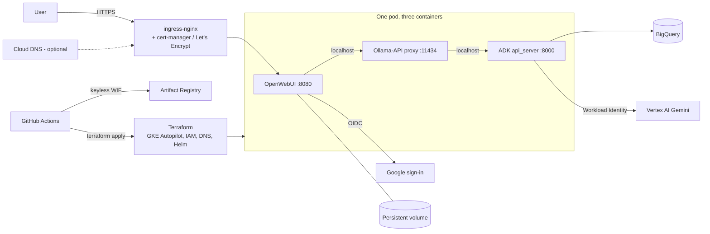

**Repo:** [JeanFraga/agentic-data-governance](https://github.com/JeanFraga/agentic-data-governance)

## Goal

A month earlier I had an ADK agent analyzing BigQuery data, but only on my laptop through `adk web` (see [Agentic Data Science]()). The next question was what it takes to give business users a real chat interface for "talk to your data," with sign-in, TLS, a custom domain, and everything deployed from code.

This project is mostly about the **platform around the agent**. The agent itself is Google's open-source ADK *Data Science* multi-agent sample (Apache-2.0). It has a root agent that routes to sub-agents for NL2SQL against BigQuery, NL2Python analytics with a code interpreter, and BigQuery ML. My work was everything needed to run it as a product.

## Architecture

- **OpenWebUI** is the chat front end. It speaks the Ollama API, so a small proxy container translates between it and the ADK backend's API.
- The three containers share **one pod** and talk over `localhost`, which keeps networking trivial.
- The ADK backend reaches Vertex AI and BigQuery through **Workload Identity**, with no keys in the cluster.
- OpenWebUI stores its data on a persistent volume.
- **Sign-in** uses Google OIDC, with a password login as a fallback.

## Infrastructure as code, for two environments

One Terraform configuration covers both environments, switched by `var.environment`:

- **production** creates:
  - the required APIs and an Artifact Registry repo
  - a **GKE Autopilot** cluster
  - an optional Cloud DNS zone
  - the ADK workload service account
  - a **Workload Identity Federation** pool limited to this repo, for GitHub Actions
  - Helm releases for ingress-nginx, cert-manager and my own chart (`webui-adk-chart`)
- **local** deploys the same chart to Docker Desktop Kubernetes on a NodePort.

On every push to `main`, CI signs in to GCP **keylessly via WIF**, builds and pushes the images tagged with the commit SHA, and runs `terraform apply`. A ~1,500-line management script (`adk-mgmt.sh`) wraps deploy, destroy, build, OAuth, DNS, quota, logs and scaling, with a dry-run mode. Destroying production requires typing `destroy-production`.

## Problems I hit (and what they taught me)

- **CPU quota on a new project.** Autopilot scale-up failed with `QUOTA_EXCEEDED`: installing ingress-nginx and cert-manager next to an oversized pod went past a new project's default regional CPU quota. I added resource limits to the chart and a quota-limited values file (about 0.6 vCPU across the three containers), plus a helper for requesting a quota increase.
- **OAuth redirect mismatches.** OpenWebUI's generic OIDC provider uses the `/oauth/oidc/callback` path, not a Google-specific one. A small diagnostic script for `redirect_uri` errors saved me hours.
- **DNS before TLS.** Let's Encrypt needs a real hostname. Before buying a domain I used nip.io hostnames, and the final setup supports a Terraform-managed zone, external DNS, or IP-only.
- **Separate state per environment.** Combining my local and production Terraform trees meant both environments read the same state, so a plan for one could propose changes to the other. I split them so every environment has its own state.

## Status and what I'd do next

The deployment platform (Terraform, Helm chart, CI, SSO, TLS) is the finished part. Before calling it production-ready I'd:

- **commit the proxy.** The Ollama-to-ADK proxy source isn't in the repo yet.
- **move Terraform state to GCS.** The production backend template still uses local state, so CI starts from scratch on every run. Bootstrapping the CI identity separately goes with this.
- **tighten defaults.** Don't make new OAuth sign-ups admins, keep the admin password in Secret Manager, and pin image tags instead of `main`/`latest`.
- **earn the name.** Add the actual governance features (policies, lineage, access rules over data) that the repo name promises.

## What I learned

Getting an agent to answer questions is the easy part. Identity, quotas, DNS, certificates, state management and safe defaults are what make it usable by other people, and that's where most of my time went.
