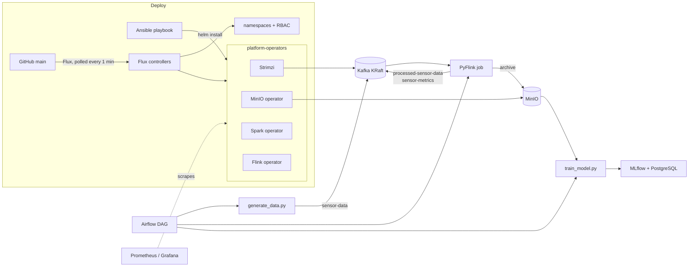

**Repo:** [JeanFraga/MLOpsInfrastructure](https://github.com/JeanFraga/MLOpsInfrastructure)

## Goal

I wanted to understand the open-source MLOps stack end to end by running all of it myself on a laptop-sized Kubernetes cluster (minikube or Docker Desktop):

| Concern | Component |
| --- | --- |
| Streaming ingest | Kafka (Strimzi operator, KRaft mode) |
| Stream & batch processing | Flink and Spark (operators) |
| Object storage | MinIO (operator + tenant) |
| Orchestration | Airflow (KubernetesExecutor) |
| Experiment tracking & registry | MLflow on PostgreSQL |
| Monitoring | Prometheus & Grafana (kube-prometheus-stack) |

The guiding rule: run **stateful systems as Kubernetes operators** and stateless ones from their official Helm charts. Workloads are split into six namespaces: operators, data plane, orchestration, ML lifecycle, processing jobs and observability.

## Architecture

## The demo pipeline: IoT anomaly detection

1. **Generate.** A Kafka producer emits synthetic temperature, humidity and pressure readings to `sensor-data`. About 5% of readings are anomalies.
2. **Process.** A **PyFlink** Table API job does three things:
   - enriches each reading and writes it to `processed-sensor-data`
   - archives raw data to MinIO over `s3a://`
   - computes **1-minute tumbling-window** aggregates per building into `sensor-metrics`
3. **Train.** A training script reads the archive from MinIO and fits supervised models (random forest, logistic regression) and unsupervised ones (isolation forest, one-class SVM). It logs every run to **MLflow** and registers the models.
4. **Orchestrate.** An Airflow DAG chains the steps: infrastructure check, topic creation, data generation and Flink processing in parallel, monitoring, training, validation and promotion, a report, then cleanup.

## Two ways to deploy: push, then pull

**Version 1 was an Ansible playbook** that bootstraps everything from a bare machine. It installs Docker, kubectl, Helm and minikube, starts a cluster if none exists, then installs cert-manager, the four operators, monitoring, Kafka, MinIO, PostgreSQL, MLflow and Airflow. Tags (`deploy`, `status`, `cleanup`, `validation`) select which parts run.

**Version 2 moved toward GitOps with Flux CD.** A `GitRepository` watches the repo's `main` branch. Two Kustomizations reconcile it:

- the base layer: namespaces and RBAC
- the operators, as `HelmRelease`s with retry remediation and health checks, so a broken operator fails the reconcile *visibly*

The goal was for Ansible to shrink to bootstrap-only while Git becomes the source of truth.

### CI

- `validate.yml`: yamllint, Helm lint, black/isort/flake8, ansible-lint and a Trivy security scan.
- `gitops-validation.yml`: spins up a **kind** cluster in GitHub Actions, installs Flux, applies the cluster config, and re-applies it to prove the config is idempotent.

## Design decisions and lessons

- **Kafka on KRaft with node pools, no ZooKeeper.** Along the way I deleted two older Kafka configs and a duplicate playbook so only one authoritative definition was left.
- **Operators earn their keep for stateful services.** Strimzi and the MinIO operator handle the lifecycle work I'd otherwise script by hand.
- **Drift is real.** Mixing a push tool (Ansible) and a pull tool (Flux) left resources on the cluster that neither one owned. I wrote a cleanup script and guide just for that, and it's the strongest argument I know for picking one deployment model.

## Honest status

The migration to Flux is **partial**. The base layer and three operators (Strimzi, MinIO, Spark) are reconciled by Flux. The Flink operator, monitoring stack, Airflow, MLflow and PostgreSQL are still installed only by Ansible, and the Kafka and MinIO instances are applied by hand. Chart versions also differ between the two paths. The demo DAG targets the Airflow 3 SDK while the cluster runs Airflow 2.10, and DAG delivery (git-sync) isn't wired up, so the full pipeline hasn't run end to end through Airflow yet.

Next steps:

- move the remaining components into Flux
- align versions
- deliver DAGs through git-sync
- delete the Ansible deploy path once Flux owns everything

## What I learned

Running every piece myself showed me where the real complexity in MLOps lives: **wiring and lifecycle**, not model code. Operators, health checks and a single source of truth for deployment matter more than any one tool in the table above.
