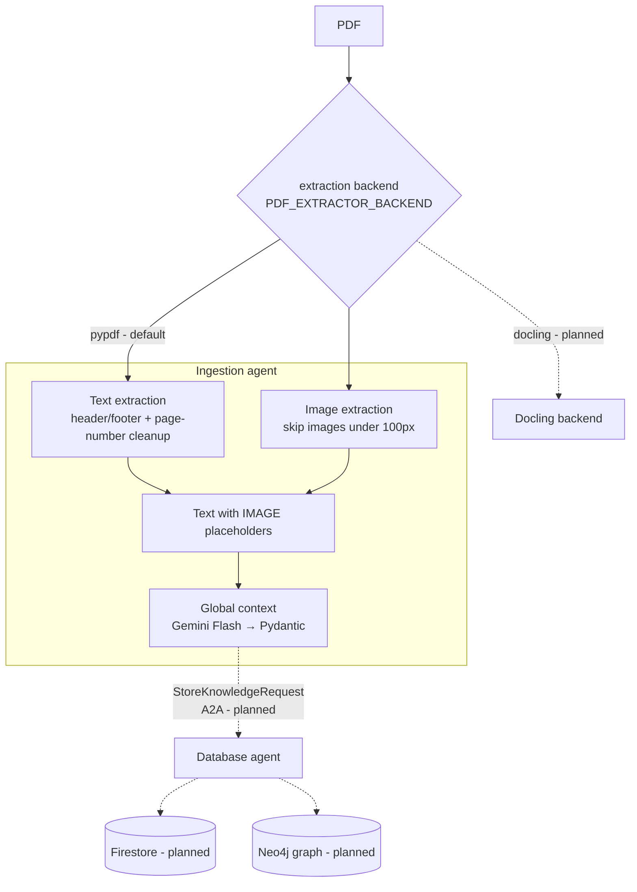

**Repo:** [JeanFraga/pdf_to_knowledge](https://github.com/JeanFraga/pdf_to_knowledge)

## The problem

A 300-page technical book is effectively dead data to an AI agent. It doesn't fit cleanly in a context window, models lose track of the middle of long inputs, and standard RAG chunking cuts concepts in half. The answers that come back can look confident and still be wrong.

My idea was **agentic chunking with context continuity**. First, generate a document-wide *Global Context*: a summary, the key terms with definitions, the main themes and the audience. Then inject that context into every chunk, so each piece still "knows" what book it came from.

The output is meant to have two layers:

1. **Strict-schema data for other agents**, including visual descriptions an infographic agent could use and tone notes for a podcast agent.
2. **Enhanced summaries for people.**

The headline success metric is that 100% of the output validates against the schema.

## Architecture

I planned this one with the BMAD method (product brief, PRD, architecture with ADRs, then epics and stories) and built it story by story. The design has two **Google ADK** agents:

Solid lines are built. Dashed lines are designed but not built yet.

### Ingestion agent: what works today

- **Text extraction** (pypdf), cleaned page by page. Repeated headers and footers are detected by comparing the first and last three lines of every page against a 70% repetition threshold. Page numbers are stripped with a set of regex patterns.
- **Image extraction.** Embedded images are pulled from the PDF's internal image objects (XObjects). Anything under 100×100 px is dropped, which removes decorations and icons. Each kept image gets an ID and an `[IMAGE: img_NNN]` placeholder in the text, so downstream steps know a visual was there.
- **Global context generation.** One Gemini call (temperature 0.3, with retries) returns a typed Pydantic `GlobalContext`: summary, document type, key terms with definitions and frequency, main themes and target audience.
- **A swappable extraction backend** (strategy pattern): pypdf for speed, with a Docling backend reserved for higher-fidelity layouts and tables.
- **About 100 unit tests**, plus integration tests you run against your own PDFs.

### The contract between agents

Before building the storage agent, I wrote the message contract it will receive: versioned Pydantic schemas (`shared/schemas/knowledge.py`).

- A `KnowledgeChunk` carries its text, the global context, the context injection, visuals and metadata (chapter, section, page range, keywords, tone, trace ID).
- A `StoreKnowledgeRequest` sends chunks to the storage agent. The `StoreKnowledgeResponse` reports per-chunk Firestore and Neo4j IDs, with a status of SUCCESS, PARTIAL, FAILED or VALIDATION_ERROR.

Agents are meant to talk over Google's agent-to-agent (A2A) protocol.

### Infrastructure

Everything is Terraform with remote state in GCS, plus an idempotent bootstrap script. The environments are split for cost:

- **dev** enables only Vertex AI and runs the agents with Docker Compose.
- **prod** adds GKE **Autopilot** (Workload Identity, deletion protection), Firestore, Artifact Registry, Cloud Build and Secret Manager.

Autopilot was a deliberate choice: as a solo developer I didn't want to manage node pools.

## Design decisions

- **Two agents instead of one.** Ingestion logic is complex and storage will change, so separating them lets each change and scale on its own (ADR-002).
- **Two databases.** Firestore for chunk content and Neo4j for relationships between concepts, chapters and books: retrieval speed on one side, relational depth on the other (ADR-003).
- **Per-agent model settings.** Each agent reads its own model environment variable, so each can be sized to its task.
- **Schema first.** Defining the A2A contract before the storage code means the ingestion side can be tested against the real shape of the data.

## Status

The ingestion layer is built: Epic 1 (infrastructure), Epic 2 (text and image extraction), global context, and the A2A schemas. Still to come:

- semantic segmentation and per-chunk context injection
- Firestore and Neo4j storage
- visual and tone analysis
- the CLI
- the Docling backend
- CI and the GKE deployment

The ADK agents are scaffolded around this logic, but the extraction functions aren't wired in as ADK tools yet. I'll write a follow-up once chunking and storage are in.

## What I learned

Defining the output schema and its success metric up front ("100% schema-valid") made every later decision easier. It also showed how much of "RAG quality" is really **document preprocessing**: headers, footers, page numbers and images decide what the model sees long before any embedding happens.
