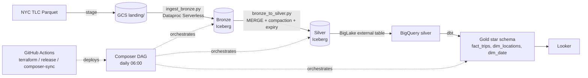
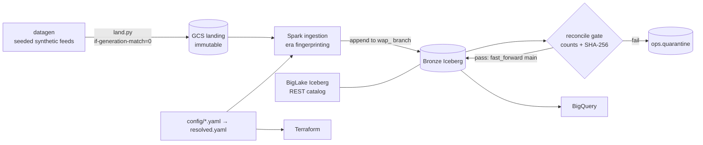

**Repo:** [JeanFraga/GitOps_Iceberg_Data_Platform](https://github.com/JeanFraga/GitOps_Iceberg_Data_Platform)

This is my biggest personal project so far: 124 commits between August and October 2026. It has two versions, on two branches:

- **`v1`** is a complete medallion lakehouse over NYC taxi data. Data runs Bronze → Silver → Gold through Iceberg, BigLake and dbt, orchestrated by Cloud Composer and deployed with Terraform and GitHub Actions.
- **`main`** is a config-driven rewrite aimed at a harder problem: healthcare payer and EMR feeds that drift over time, modeled as a Data Vault. It is built through the Bronze layer so far.

This post covers both: what v1 taught me, and how that shaped the rewrite.

## v1: the NYC taxi lakehouse

### Goal

I wanted a cost-conscious lakehouse on GCP. Bronze and Silver are open **Apache Iceberg** tables on Cloud Storage. Gold is native **BigQuery**, built by dbt and exposed to Looker.

### Bronze: idempotent monthly loads

`ingest_bronze.py` runs on **Dataproc Serverless**. It normalizes column names to snake_case, projects them onto a canonical column list, and filters rows to a single `--period YYYY-MM`. It writes with `overwritePartitions()` into a table partitioned by `days(tpep_pickup_datetime)`. Re-running a month replaces only that month's partitions and never touches other months.

### Silver: MERGE, compaction and snapshot expiry

`bronze_to_silver.py` drops invalid rows (non-positive distance or amount, null keys), dedupes, and then runs an Iceberg **`MERGE INTO`** on a five-column business key: vendor, pickup time, dropoff time, pickup location and dropoff location. I learned the hard way that vendor plus pickup time is *not* unique in this data.

After the merge, the job does Iceberg housekeeping. `rewrite_data_files` compacts small files, sorted by pickup time. `expire_snapshots(retain_last => 5)` keeps metadata from growing without bound.

### Getting Iceberg into BigQuery

v1 used an Iceberg **Hadoop catalog** on GCS. BigQuery reads Silver through a **BigLake external table** that points at the table's current `vN.metadata.json`, found through `version-hint.text`. A pipeline step re-registers that pointer after every Silver write.

### Gold: a dbt star schema

The dbt project (`nyc_taxi_gold`) has:

- `stg_yellow_trips`: a staging view with `SELECT DISTINCT`. MERGE upserts but never deletes, so staging dedupes defensively.
- `fact_trips`: the fact table, with a surrogate `trip_id` built from a fingerprint of the full business key.
- `dim_locations`: built from a taxi-zone seed.
- `dim_date`: the date dimension.

Schema tests cover `not_null`/`unique` on every key and `relationships` from the fact to the location dimension.

### Orchestration and CI/CD

A **Cloud Composer 3** DAG runs daily:

`resolve_next_period → stage_to_landing → ingest_bronze → mark_bronze_loaded → bronze_to_silver → register_silver → dbt_build`

The DAG tracks progress with **success markers in GCS**, not by checking whether Iceberg data files exist. Iceberg writes data files *before* the metadata commit, so files existing doesn't mean a load succeeded.

The whole platform is in **Terraform**: buckets with lifecycle rules, BigQuery datasets, the BigLake connection, Composer and Looker. Three GitHub Actions workflows deploy it:

- `terraform.yml`: fmt, validate and tflint; the plan is posted to the PR and applied on merge.
- `release.yml`: ruff, a DAG compile check, `dbt parse` and pytest on every PR. The Spark and dbt layers run only on manual dispatch, so CI and the scheduler can never be two concurrent writers to the same Iceberg table.
- `composer-sync.yml`: syncs DAGs and the dbt project to the Composer bucket.

Composer and Looker sit behind Terraform feature flags. They are the expensive parts, and I wanted to switch them off between experiments.

## main: rebuilding it config-first for healthcare

v1 worked, but every new dataset would have meant new code. For the rewrite I picked a harder domain than taxis, closer to my day job: **synthetic multi-payer healthcare data**. That means X12 834/835/837 claims files, pharmacy CSVs, a second payer's member file, FHIR R4 NDJSON from an EMR, and a provider directory. The generator is seeded and deterministic. It deliberately injects schema drift and data drift, and writes the ground truth so identity resolution can be *measured* later.

The design goals from the PRD:

- Onboarding a new payer should be **configuration, not code**.
- The whole demo should run **for under USD 5**.
- Every architectural decision is recorded (AD-1 … AD-25).

What's built so far:

- **One YAML contract.** `config/defaults.yaml` and a profile are deep-merged into a committed `resolved.yaml`, validated by JSON Schema. Terraform reads that same file with `yamldecode`. Cost flags (Composer, Workflows, scheduled Dataproc) default to **off**, and BigQuery jobs have a bytes-billed cap enforced by a lint rule.
- **Immutable landing.** Files land under `source=/feed=/ingest_date=/sha256=/` with a no-overwrite precondition. The bucket moves them to Coldline after 7 days and Archive after 60.
- **Write-audit-publish into Bronze.** Each file is appended to an Iceberg branch `wap_<sha8>`. A reconcile gate checks record counts and per-record SHA-256 hashes against the landing file. Only then does `fast_forward` publish to `main`; a failure quarantines the file. Snapshots are tagged with the run ID and file hash.
- **Schema eras by fingerprint.** Each file's schema is fingerprinted and routed to a known era, an additive era, or an `unmapped_<fp>` table. Each routing decision writes a row to `ops.drift_report`. The rule is to never guess an era from dates or file names.
- **BigLake Iceberg REST catalog** instead of the Hadoop catalog, so BigQuery reads Bronze tables directly by name. A live run on 2026-10-08 read the landed rows back from BigQuery. One gotcha: BigLake rejects column names starting with `_file_`, so I renamed my lineage column.
- **216 tests and a `make validate` gate**: ruff, pytest, config validation, a PHI scan, tf validate and tflint.

## What I changed my mind about

- **Iceberg only in Bronze.** In v1, Silver was Iceberg too. In the rewrite, Bronze is append-only Iceberg (no MERGE, no row rewrites), and Silver onward is native BigQuery built by dbt. One writer per table class keeps concurrency simple.
- **Hashing.** v1 used `FARM_FINGERPRINT` for keys. The Data Vault design standardizes on an MD5 hash spec with golden test vectors, so hashes are reproducible outside BigQuery.
- **Upgrades through a pinned `versions.yaml`** (Spark 4.0, Iceberg 1.12, Dataproc runtime 3.0) and a `make upgrade` routine, instead of automated dependency PRs.

## What's next

The rewrite's remaining epics: switch ingestion to Dataproc Serverless, then build canonical Silver, the Raw Vault, identity resolution (MPI) evaluated against the generator's ground truth, the Business Vault and Gold, and finally GitHub Actions deployment with Workload Identity Federation. v1 stays on its branch as the reference implementation.
