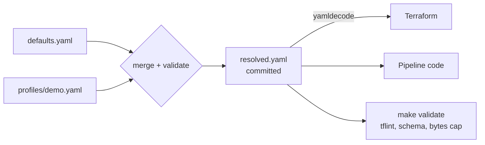

When I started working with data at Sanitas, there was **no source control**. Code lived in shared drives and deployments were done by hand. Nobody could answer "what's running in production, and who changed it?" with confidence.

Infrastructure as code (IaC) is the answer I keep coming back to. If it isn't in Git, it doesn't exist. Here's how my practice evolved across projects, including the mistakes.

## Lesson 1: put *everything* in code, including IAM

In [Agentic Data Science]() (May 2025), I began by creating service accounts by hand in the console. When I moved them into Terraform, I found duplicate IAM definitions, and one of them quietly granted my Cloud Function `bigquery.admin`. Putting everything in code turned "who has access?" into a code review question. The function ended up with three narrow roles instead of an admin role.

## Lesson 2: state is sacred, and each environment needs its own

Terraform state is Terraform's record of what it has already created. In [Agentic Data Governance]() (June 2025), I combined my local and production Terraform folders into one configuration, and both environments ended up reading the **same state**. With shared state, a plan run for one environment can propose changes to the other, so I split them: each environment now has its own state.

Since then:

- state lives in a versioned GCS bucket
- every environment gets its own state
- the bucket that holds state is created by a small bootstrap step, outside the stack it serves

## Lesson 3: stop handing CI a key

My first CI pipeline authenticated to GCP with a service-account JSON key stored as a GitHub secret. A month later I switched to **Workload Identity Federation**: GitHub Actions exchanges its own short-lived identity token for GCP credentials, scoped to one repository. There's no key to leak or rotate.

## Lesson 4: push vs. pull, and why you should pick one

In [MLOps Infrastructure]() (July 2025), I deployed a Kubernetes platform with **Ansible** (push) and then started moving to **Flux** (pull: the cluster continuously reconciles itself to what's in Git). Running both at once left resources on the cluster that neither tool owned, and I had to write a cleanup script just for that drift.

GitOps works best when exactly one thing has the authority to change the system.

## Lesson 5: make the expensive things switchable

Cloud Composer and Looker are the most expensive parts of my [Iceberg lakehouse](). In Terraform they sit behind `composer_enabled` and `looker_enabled` flags. In the rewrite, every cost flag **defaults to off**, and a lint rule enforces a cap on bytes billed per BigQuery query.

Cost control becomes a code review topic instead of a surprise on the bill.

## Lesson 6: one contract to rule them all

The most recent step: my platform has a single YAML configuration contract. Defaults and an environment profile are deep-merged into a committed `resolved.yaml`, which is validated by JSON Schema.

Terraform reads that file with `yamldecode`, and the pipeline code reads the same file. A bucket name or region is defined **once**, so the infrastructure and the code can't disagree.

## My IaC checklist today

- [x] Terraform for everything, IAM included. No console clicks that matter.
- [x] Remote, versioned state, separate per environment.
- [x] Pinned Terraform and provider versions, upgraded deliberately.
- [x] `fmt`, `validate` and `tflint` in CI, with the plan posted to the PR.
- [x] Keyless CI with Workload Identity Federation.
- [x] Expensive resources behind flags that default to off.
- [x] One configuration contract shared by infrastructure and code.

## Why "love"?

Because IaC changes the conversation. "Can we rebuild this?" becomes `terraform apply`. "Who changed this?" becomes `git log`. "Is this safe?" becomes a plan diff in a pull request.

That's also why I was the first person at Sanitas to bring in source control and Terraform. Once you've worked this way, clicking through a console feels like editing production with your eyes closed.
