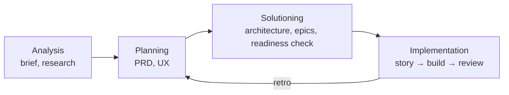

AI coding assistants are fast and confidently wrong. Ask one for "a lakehouse on GCP" and you get plausible code built on assumptions nobody wrote down. The fix that has worked for me is **spec-driven development**: agree on what to build and why before any code exists. My framework for that is the **BMAD Method**.

## What BMAD is

The BMAD Method (*Breakthrough Method for Agile AI-Driven Development*) is an open-source, MIT-licensed framework from BMad Code. It gives your AI tools **specialized agent personas**:

- Analyst
- Product Manager
- Architect
- UX designer
- Scrum Master
- Developer
- QA / Test Architect

They work through an agile flow:

It's *scale-adaptive*: a bug fix gets a light process, and a multi-epic initiative gets the full one. It runs inside the tools I already use, including Claude Code, GitHub Copilot and Cursor.

## Project 1: pdf_to_knowledge (BMAD v6.0, GitHub Copilot)

For [pdf_to_knowledge]() (Nov 2025 – Feb 2026), I installed BMAD v6.0 with its Method and Test Architect modules as nine Copilot chat modes. I followed the full "method" track:

- a **product brief**, then a **PRD**, then an **architecture** with four ADRs: why Google ADK, why separate ingestion and storage agents, why Firestore plus Neo4j, and why a swappable PDF backend
- **epics and stories**: 7 epics and 19 stories
- an **implementation-readiness report** before any code
- for every story, a dev record and a **senior developer review** that checked acceptance criteria and tasks

What the process gave me:

- **Risk-ordered work.** The readiness check flagged schema evolution as the top risk, so I built the agent-to-agent message contract *before* the storage agent.
- **Honest estimates.** Sprint 2 stories were estimated at 2–3 days and took about 1. Now I know how far off my estimates were.

## Project 2: GitOps Iceberg Data Platform (BMAD 6.13, Claude Code)

By October 2026 BMAD had moved to **skills**: small, composable capabilities that coding agents load on demand. I used about 29 of them in Claude Code for the healthcare Data Vault rewrite of my [Iceberg platform](). The planning went much deeper:

- a **PRD** with 40 functional and 10 non-functional requirements
- an **architecture** with 25 numbered decisions and a running decision log
- a **spec** with a requirements catalog and a **glossary** of domain terms
- a `tickets.toml` that splits the initiative into **12 epics** with dependencies, and 35 story tickets so far, each with its verification steps, what it covers, and its risk
- a **plan file per story** that records the route, risk, review lens, a review verdict table, test counts and remaining risk

Every commit names its story. `feat(...): Bronze tracer (3.1)` is followed by `fix(...): review patches (3.1 review)`. A reader can trace any line of code back to a requirement.

## Where it paid off: reviews before code

The biggest value came from **adversarial reviews of the plans**, run by agents told to find what would break:

- The architecture review found that **two parts of the design fingerprinted schemas with incompatible algorithms**. In practice, every file would have been routed to "unmapped". The fix became a new decision (AD-22): one fingerprint spec with golden test vectors.
- It also caught a naming clash (`unmapped-` vs `unmapped_`) and **three components writing to the same ops tables**. That became the "one writer per table class" rule.
- A **PHI and data-integrity review** found that one tokenization design couldn't actually be built in BigQuery, and that one restricted table had no defined writer.
- A **healthcare domain review** of the PRD pointed out that member keys must be scoped per payer, that 837 claim files don't carry paid amounts (those come in 835s), and that pharmacy wasn't modeled. Each finding became a story, and each story shipped.
- Story-level code reviews found real bugs. One example: a crash between publish and reconcile would have caused a double publish on reload. It was fixed with recovery logic and a test.

None of those would have been cheap to find in production.

## Making it mine

BMAD is extensible, and I've started writing my own skills. My `platform-upgrade` skill encodes my dependency policy:

- move to the latest stable release
- pin exact versions
- wait 7 days after a release
- skip known-bad builds

It's tied back to the architecture decisions that require it. I run it on demand instead of letting bots open upgrade PRs.

## Takeaways

1. **Specs are cheaper than refactors.** An afternoon of adversarial review saved days of rework.
2. **Traceability is a feature.** Requirement → decision → ticket → commit → review makes AI-written code auditable.
3. **Scale the process to the work.** I don't write a PRD for a typo. I do for a healthcare platform.
4. **The human still owns the decisions.** The agents draft, challenge and implement. I approve the architecture and verify the stories.
