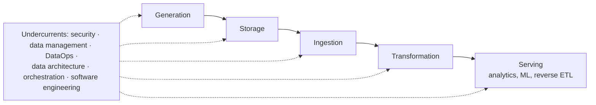

In October–November 2024 I read **[Fundamentals of Data Engineering](https://www.oreilly.com/library/view/fundamentals-of-data/9781098108298/)** by Joe Reis and Matt Housley (O'Reilly, 2022). I came to data engineering sideways, through analysis and data science, and had learned the field one tool at a time. This book gave me the map I'd been missing.

## The big idea: a lifecycle, not a tool list

The book deliberately avoids teaching specific tools. Instead it describes the **data engineering lifecycle** and the **undercurrents** that run beneath every stage:

Storage appears as its own stage, but it also runs under all the others. The book's structure follows the same arc:

- **Part I**: foundations, good data architecture, and choosing technologies
- **Part II**: one chapter per lifecycle stage
- **Part III**: security, privacy and the future of the field

## Three ideas I use every week

**1. Choose technologies by lifecycle stage and trade-off, not hype.** The chapter on choosing technologies treats cost, team size, speed to market, interoperability, and build-vs-buy as real engineering constraints. When I picked managed Dataproc Serverless and BigQuery over running my own clusters for a demo platform, that was this chapter's reasoning: spend effort where it differentiates.

**2. The undercurrents are where projects fail.** Ingestion and transformation get the attention. Security, data management and DataOps are what break in production. At Sanitas I treat data quality as a pipeline step, not an afterthought: 10 sources are under metadata validation, with runs that **fail** when quality falls below a threshold, so errors get caught before they reach dashboards.

**3. "Reversible decisions" as an architecture principle.** The architecture chapter argues for loosely coupled systems and decisions that are easy to undo. My platforms use open table formats (Apache Iceberg), declarative infrastructure (Terraform) and configuration over code, so I can change engines or clouds without rewriting everything.

## Where the book shows up in my projects

| Lifecycle stage | In my [Iceberg platform]() |
| --- | --- |
| Generation | A seeded synthetic generator for payer and EMR feeds, schema drift included |
| Storage | Immutable GCS landing with lifecycle tiers; Iceberg Bronze |
| Ingestion | Write-audit-publish with a reconcile gate |
| Transformation | dbt models on BigQuery (star schema in v1, Data Vault planned) |
| Serving | Gold tables for BI and Looker |
| Undercurrents | Terraform, CI validation, cost caps, PHI scans, an ops/run-events schema |

## Who should read it

- **Analysts and data scientists moving into data engineering.** That was me. It explains *why* the platform looks the way it does.
- **Engineers who know one stack deeply.** It helps you see what transfers to another stack.
- **Anyone preparing for a cloud data engineering certification.** The lifecycle maps closely onto how the Google Professional Data Engineer exam guide is organized: design, ingest and process, store, prepare and serve, maintain and automate.

The next book I read was *Learning Domain-Driven Design*, which tackles a question this one leaves open: how to decide **where the boundaries go**. I wrote about it [here]().
