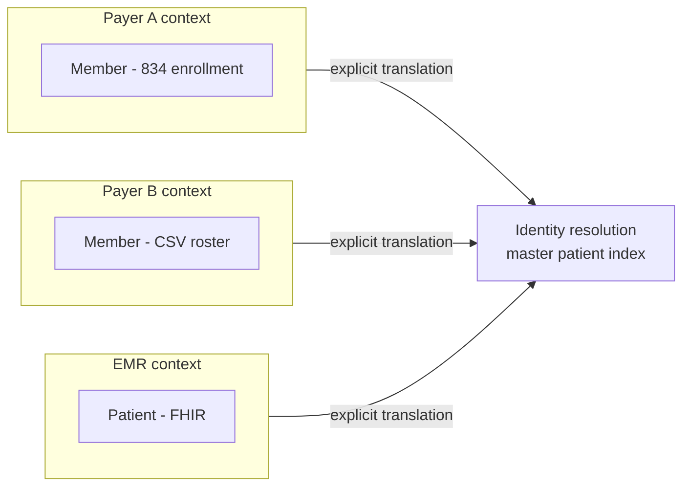

From December 2024 to March 2025 I read **[Learning Domain-Driven Design](https://www.oreilly.com/library/view/learning-domain-driven-design/9781098100124/)** by Vlad Khononov (O'Reilly, 2021). It's written for software engineers building business applications. I read it as a data engineer in healthcare, and it changed how I think about data models more than any data-modeling book has.

## What the book covers

The book has four parts:

1. **Strategic design**: analyzing business domains, discovering domain knowledge, and bounded contexts and how they integrate.
2. **Tactical design**: patterns for simple and complex business logic, modeling time (event sourcing), and architectural and communication patterns.
3. **DDD in practice**: design heuristics, evolving decisions, EventStorming, and introducing DDD in real organizations.
4. **Relationships to other methodologies**: microservices, event-driven architecture, and **data mesh**.

## Idea 1: not all subdomains deserve the same investment

DDD splits a business into **core** subdomains (what makes you different), **supporting** ones (necessary but not differentiating), and **generic** ones (solved problems you should buy).

For a healthcare data platform, that's a useful lens:

- **Core:** reconciling clinical outcomes from EMR data against payer claims, and identity resolution across payers. This is where custom modeling and testing pay off.
- **Supporting:** landing files, tracking runs, quarantining bad data.
- **Generic:** storage, compute, the catalog, BI. Use managed services and move on.

That's roughly how I spend effort on my [Iceberg platform](). The healthcare logic gets the deep design, and everything generic is a managed GCP service.

## Idea 2: ubiquitous language, the glossary is a deliverable

DDD insists that engineers and domain experts use **the same words, with the same meanings**, in conversation, documents and code. In healthcare data, words like "member", "claim", "encounter" and "paid amount" mean different things to a payer, a clinic and an EMR vendor.

My platform's spec now ships with a `glossary.md`, and table and column names follow it. When a review pointed out that member keys must be **scoped per payer**, the glossary made the fix clear: "member" is only meaningful *within* a payer's context.

## Idea 3: bounded contexts are where models are allowed to differ

The book's key move is to *stop forcing one universal model*. Each bounded context keeps its own model, and integration between contexts is explicit, through translation layers or published contracts.

This maps directly onto a Data Vault design. Each source keeps its own raw shape in Bronze and the Raw Vault, and identity resolution is an explicit translation step instead of an accidental join.

## Idea 4: data mesh is DDD applied to analytics

The last chapter connects DDD to **data mesh**: domain-owned data products, treated as products, on a self-serve platform with federated governance. Reading it alongside Google's Dataplex (now Knowledge Catalog) data mesh labs made the concept concrete. Data mesh is less about a technology and more about drawing **ownership boundaries** that match the business.

## What I'd tell other data engineers

- **Read Part I first, and slowly.** Strategic design is the part that transfers most directly to data work.
- **Skim the tactical patterns.** They're aimed at application code, but event sourcing and "modeling the dimension of time" will feel familiar if you've built slowly changing dimensions or append-only Bronze layers.
- **Use EventStorming with stakeholders.** It's a fast, low-tech way to discover the business events your pipelines should capture.

Paired with *[Fundamentals of Data Engineering]()*, these two books are the foundation I reach for most: one explains **how data flows**, the other explains **whose language it speaks**.
