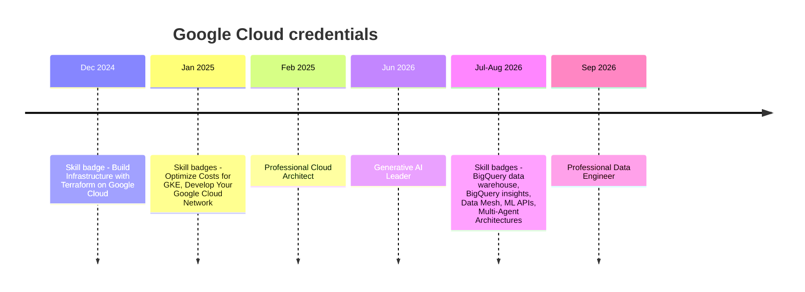

Between February 2025 and September 2026 I earned three Google Cloud certifications: **Professional Cloud Architect**, **Generative AI Leader** and **Professional Data Engineer**. This post covers the order I took them in, how I prepared, and what each exam actually tests today, since all three changed during that time.

## Where I started

Certifications weren't new to me. In 2022–2023 I earned the AWS Certified Cloud Practitioner, the TensorFlow Developer Certificate and the AWS Certified Machine Learning – Specialty. All three have since expired, and I let them. My day-to-day work had moved to BigQuery and Google Cloud at Sanitas, where I ended up leading the company's first Google Cloud team. I wanted credentials that matched the platform I was actually building on.

## The timeline

The pattern is visible: **hands-on skill badges first, then the exam.**

## Skill badges as exam practice

A Google Cloud skill badge is a short series of hands-on labs that ends in a **challenge lab**: you're given a goal and no step-by-step instructions, and the lab checks your work. That makes them a good test of whether you can actually *do* the thing, not just recognize the right answer.

Before the Cloud Architect exam I did the Terraform, GKE cost-optimization and networking badges. I still have my attempts and solution scripts in a `GCP Cert/Cloud Professional Architect` folder. Before the Data Engineer exam I did five more: building a BigQuery data warehouse, deriving insights from BigQuery, building a data mesh with Dataplex (since renamed Knowledge Catalog), preparing data for ML APIs, and deploying multi-agent architectures with ADK, A2A and MCP.

## Professional Cloud Architect (February 2025)

**Exam:** 2 hours, 50–60 multiple-choice and multiple-select questions, $200. About a quarter of the questions are built around **case studies** of fictional companies, shown on a split screen.

The exam guide weights the sections like this:

| Section | Weight |
| --- | --- |
| Designing and planning a cloud solution architecture | ~25% |
| Managing and provisioning infrastructure | ~17.5% |
| Designing for security and compliance | ~17.5% |
| Analyzing and optimizing technical and business processes | ~15% |
| Managing implementation | ~12.5% |
| Ensuring solution and operations excellence | ~12.5% |

This exam is about trade-offs. Most questions offer several technically valid answers, and the right one is the answer that fits the case study's constraints: cost, compliance, migration timeline, team skills.

The exam has changed since I took it. A new version went live in late October 2025 with a new set of case studies (Altostrat Media, Cymbal Retail, EHR Healthcare and KnightMotives Automotive). It added AI services, Model Armor, the Well-Architected Framework, and more infrastructure-as-code.

**What it changed for me:** within months I was building [Agentic Data Science]() and [Agentic Data Governance]() with least-privilege service accounts, Workload Identity Federation, GKE Autopilot and Terraform. Those are all architect-exam topics, done for real.

## Generative AI Leader (June 2026)

**Exam:** 90 minutes, 50–60 multiple-choice questions, $99, valid for 3 years. It's aimed at any role, including non-technical ones. The four sections:

- generative AI fundamentals (~30%)
- Google Cloud's gen AI offerings (~35%)
- techniques to improve model output, such as prompting, grounding and RAG (~20%)
- business strategy, security and responsible AI (~15%)

I'd been building agents with Google ADK for a year by then, so the technical content was familiar. The value was in the **business framing**: when a gen AI solution is worth it, how to talk about grounding and responsible AI with stakeholders, and how Google's product names fit together after the 2026 renaming (Vertex AI features now live under the Gemini Enterprise Agent Platform).

## Professional Data Engineer (September 2026)

**Exam:** 2 hours, 40–50 questions, $200, valid for 2 years. The five sections:

| Section | Weight |
| --- | --- |
| Designing data processing systems | ~22% |
| Ingesting and processing data | ~25% |
| Storing data | ~20% |
| Preparing and using data for analysis | ~15% |
| Maintaining and automating data workloads | ~18% |

The current guide covers material that wasn't there a few years ago: data lakes and governance across platforms, data sharing, and preparing data for ML, including **embeddings and RAG**.

This was the certification closest to my daily work, and I studied for it while building the [GitOps Iceberg Data Platform](). Iceberg on GCS through BigLake, Dataproc Serverless, dbt on BigQuery, Composer orchestration, partitioning, cost controls: the project and the exam guide overlapped almost line for line.

## Advice if you're starting

1. **Start with the official exam guide** and treat its section weights as your study budget.
2. **Do the skill badges for your weak areas.** The challenge labs show you what you can do without hints.
3. **Build something real alongside.** Every service I used in a personal project was a question I didn't have to memorize.
4. **Read case studies for constraints, not technology.** That's how architect questions are scored.
5. **Plan renewal now.** Professional certs last two years. There's a shorter renewal exam, and badges completed through Google Skills (formerly Cloud Skills Boost) in the last year can also count toward renewal.

## What's next

My Cloud Architect certification comes up for renewal in February 2027. Until then, I'm putting the Data Engineer material to work on the healthcare Data Vault platform.
